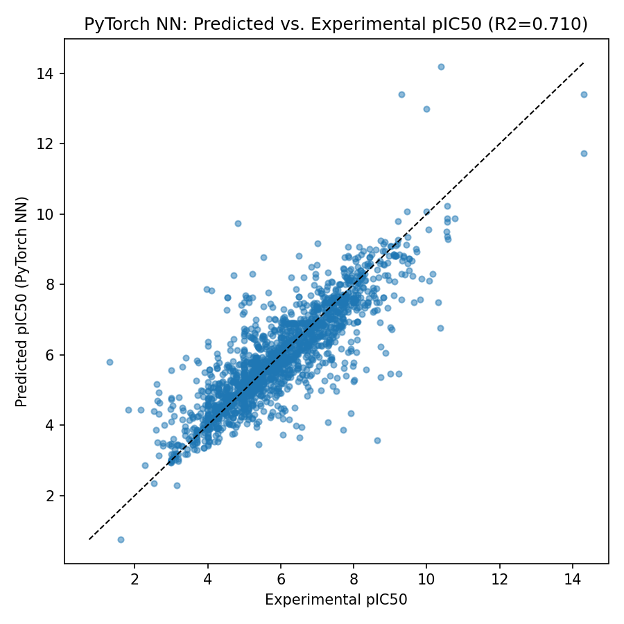
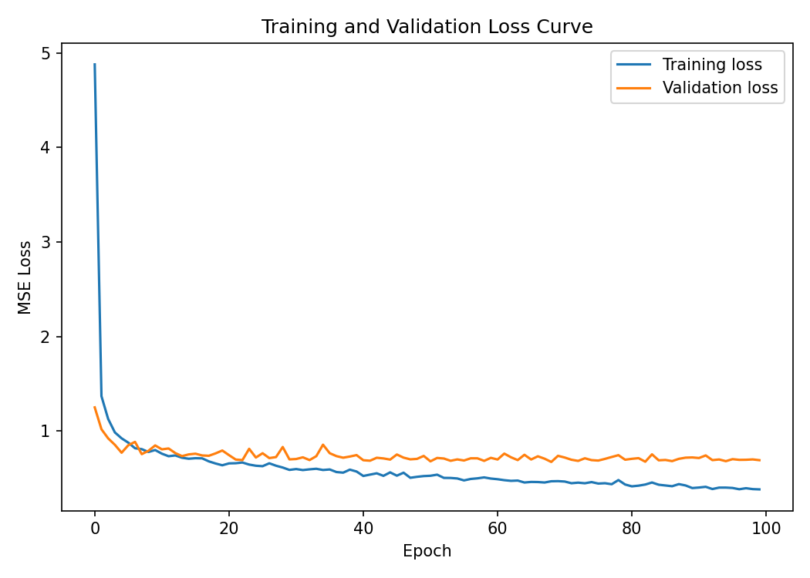
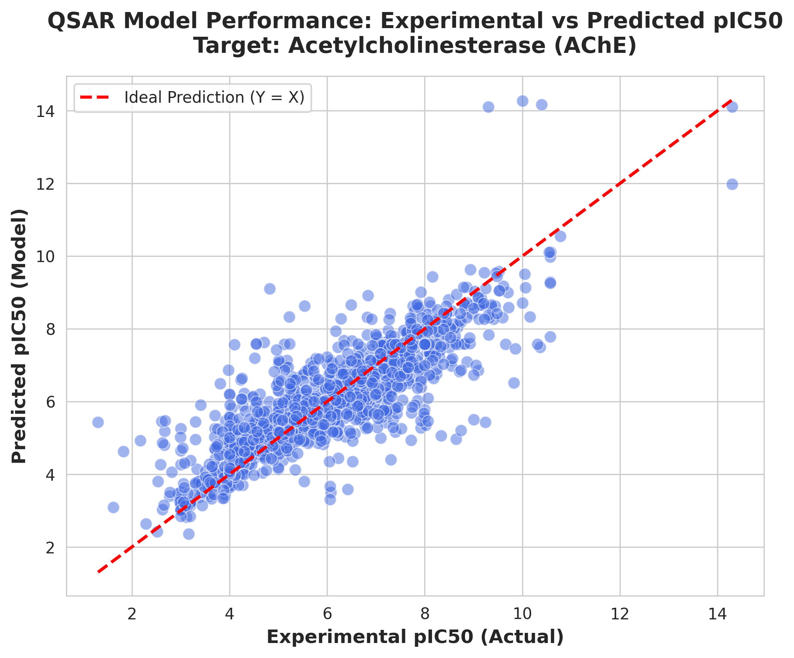

# AChE Inhibitor QSAR Machine Learning Pipeline

*Disclaimer: This is an independent portfolio project and is not connected to published research.*

This repository contains a comprehensive, end-to-end Machine Learning and Chemoinformatics pipeline designed to predict the bioactivity (pIC50) of chemical compounds targeting **Acetylcholinesterase (AChE)**. AChE is an important molecular target in Alzheimer's disease research and is widely investigated in medicinal chemistry and drug discovery.

The pipeline automates data retrieval, molecular feature engineering, regression modeling, and statistical evaluation.

---

## Pipeline Architecture & Workflow

1. **Data Collection**: Automated extraction of bioactivity data (IC50) for Human Acetylcholinesterase (`CHEMBL220`) from the ChEMBL database using the official web resource client.
2. **Data Preprocessing**: Stricter data filtering, conversion of standard string values to floats, dropping missing columns, and transforming IC50 values into a standardized logarithmic scale (pIC50 = -log10(IC50)).
3. **Feature Engineering**: Conversion of canonical SMILES strings into 2048-bit Morgan Fingerprints (radius = 2) utilizing RDKit to represent molecular structures numerically. 
4. **Model Training**: Implementation of a Random Forest Regressor (n_estimators=100) using an 80/20 train/test split.
5. **Evaluation & Visualization**: Performance tracking via R2 and RMSE metrics, backed by high-resolution scatter plots comparing experimental vs. predicted values.
6. **PyTorch Comparison**: A feedforward neural network (2 hidden layers, dropout) trained on the identical fingerprint features and train/test split, for a direct, fair comparison against the Random Forest baseline.
7. **Cross-Validation**: 5-fold evaluation of both models with random, molecule-grouped and scaffold-grouped splits.
   
---

## Model Performance Results
On a random 80/20 split of the IC50 records, the Random Forest model scored:

* **Dataset Size:** 8,790 IC50 records (7,176 unique molecules)
* **Dataset Structure:** 2,050 total columns
  * **Features:** 2,048 Morgan fingerprint bits (used for training)
  * **Identifier:** 1 column (`molecule_chembl_id`)
  * **Target:** 1 column (`pIC50`)
* **R-squared (R2) Score:** 0.722
* **RMSE (Root Mean Squared Error):** 0.815

### Dataset Characteristics

- Total IC50 records: 8,790
- Unique molecules: 7,176
- Additional records sharing molecule IDs: 1,614
- Unique Bemis–Murcko scaffolds: 2,854
- Acyclic records: 52
- Largest scaffold group: 364 records (4.1%)

The dataset contains multiple IC50 records associated with some molecule identifiers. Therefore, molecule-grouped and scaffold-grouped validation were included to investigate how different splitting strategies affect model generalization.

## Limitations & Next Steps

This project represents a baseline QSAR machine learning workflow rather than a fully optimized predictive model:
- Default hyperparameters for both models — no tuning performed
- The headline numbers come from a random 80/20 split of IC50 records, which is optimistic for chemical data: with scaffold-grouped folds the mean R² falls to about 0.5 (see Grouped Cross-Validation)
- Records sharing a molecule ID are kept as separate records, not aggregated
- Feature space limited to Morgan fingerprints — no combination with physicochemical descriptors
- Only two model families compared (Random Forest and a feedforward neural network)
- Five folds give wide uncertainty on small differences between the two models

Natural next steps: hyperparameter search, a gradient-boosted or linear baseline, and aggregating records per molecule.

## PyTorch vs. Random Forest Comparison

A PyTorch feedforward neural network was trained on the exact same 2048-bit fingerprint features and the same train/test split as the Random Forest model, for a direct comparison:

| Model | R² | RMSE |
|---|---|---|
| Random Forest | 0.722 | 0.815 |
| PyTorch NN | 0.710 | 0.832 |

The Random Forest model slightly outperformed the PyTorch neural network on the held-out test set. This result provides a useful baseline comparison for tabular molecular fingerprint data rather than indicating a failure of the neural network approach.




## Cross-Validation

`06_cross_validation.py` evaluates both models on the same 5 random folds (KFold, shuffled, seed 42). Random folds split individual IC50 records, so records that share a molecule ID, or close analogs, can fall on both sides of a split:

| Model | R² (mean ± SD) | RMSE (mean ± SD) |
|---|---|---|
| Random Forest | 0.723 ± 0.007 | 0.828 ± 0.024 |
| PyTorch NN | 0.696 ± 0.020 | 0.867 ± 0.041 |

The Random Forest had the higher R² in 5 of 5 folds. Per-fold scores are in `cv_results.csv`.

### Grouped Cross-Validation

`07_grouped_cross_validation.py` repeats the 5-fold evaluation with related records kept together (scikit-learn `GroupKFold`):

- **Molecule-grouped:** all records with the same `molecule_chembl_id` stay in the same fold.
- **Scaffold-grouped:** all molecules sharing a Bemis–Murcko scaffold stay in the same fold, so each test fold contains only scaffolds absent from the training data (acyclic molecules are grouped by their own ID).

| Split | Model | R² (mean ± SD) | RMSE (mean ± SD) |
|---|---|---|---|
| Random rows | Random Forest | 0.723 ± 0.007 | 0.828 ± 0.024 |
| Random rows | PyTorch NN | 0.696 ± 0.020 | 0.867 ± 0.041 |
| Molecule-grouped | Random Forest | 0.705 ± 0.031 | 0.854 ± 0.055 |
| Molecule-grouped | PyTorch NN | 0.693 ± 0.035 | 0.870 ± 0.056 |
| Scaffold-grouped | Random Forest | 0.542 ± 0.072 | 1.057 ± 0.070 |
| Scaffold-grouped | PyTorch NN | 0.510 ± 0.092 | 1.091 ± 0.079 |

- Keeping records that share a molecule ID together lowers R² only slightly (Random Forest 0.723 → 0.705).
- Scaffold-grouped validation revealed substantially lower predictive performance on previously unseen chemical scaffolds: mean R² fell by about 0.18–0.19 for both models relative to random folds.
- With grouped folds the Random Forest has the higher R² in 4 of 5 folds, but the mean gap between the models (0.01 molecule-grouped, 0.03 scaffold-grouped) is small relative to fold-to-fold variation, so the two are not clearly separated.

Per-fold scores are in `grouped_cv_results.csv`.

## Experimental vs. Predicted pIC50
Below is the correlation plot generated by the visualization script, showcasing the model's accuracy against the ideal prediction diagonal (Y = X):



---

## Usage

### 1. Prerequisites

Ensure you have the required chemical informatics and machine learning stack installed:

```bash
pip install chembl_webresource_client pandas numpy rdkit scikit-learn matplotlib seaborn torch
```

### 2. Execution Steps

Execute the scripts sequentially to regenerate the model from scratch:

```bash
python 01_data_collection.py
python 02_feature_engineering.py
python 03_model_training.py
python 04_visualization.py
python 05_pytorch_comparison.py
python 06_cross_validation.py
python 07_grouped_cross_validation.py
```

`07_grouped_cross_validation.py` also reads `bioactivity_data_raw.csv` (written by step 1) to recover the SMILES needed for scaffolds.

## Scientific Context & References

- **ChEMBL Database:** Gaulton, A. et al. *ChEMBL: a large-scale bioactivity database for drug discovery.* Nucleic Acids Research, 40(D1), D1100–D1107 (2012).

- **RDKit:** Open-source cheminformatics software toolkit. https://www.rdkit.org

- **Random Forest in QSAR:** Svetnik, V. et al. *Random Forest: a classification and regression tool for quantitative structure-activity relationship modeling.* Journal of Chemical Information and Computer Sciences, 43(6), 1947–1958 (2003).
